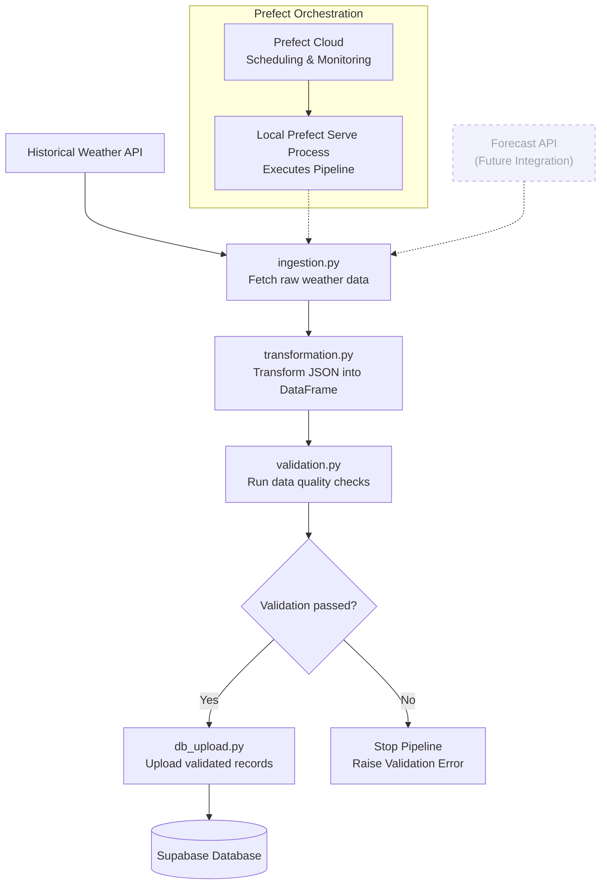

# Climate-Pipeline

**An automated weather data engineering pipeline built with Python, Prefect, and Supabase.**

## Overview

Climate-Pipeline is a data engineering project designed to automate the collection, transformation, validation, and storage of weather data.

The project implements a modular data pipeline that retrieves historical weather observations from a weather API, transforms raw JSON responses into structured datasets, performs data quality checks, and uploads validated records to Supabase.

Pipeline execution is orchestrated using **Prefect 3**, with Prefect Cloud providing deployment management, scheduling, execution monitoring, and visibility into pipeline runs.

The initial implementation focuses on historical weather data. Forecast API integration will be introduced in a future development phase to expand the pipeline into a more comprehensive climate data platform.

## Objectives

- Automate historical weather data ingestion.
- Transform raw API responses into structured datasets.
- Implement data quality validation before database ingestion.
- Store validated weather observations in Supabase.
- Orchestrate pipeline execution using Prefect.
- Automate scheduled pipeline runs.
- Establish a foundation for integrating weather forecasts.


## Architecture

The diagram below illustrates the Climate-Pipeline architecture, including data ingestion, transformation, validation, storage, and Prefect orchestration.




## Pipeline Components

| Component | Responsibility |
|---|---|
| Ingestion | Retrieves historical weather data and saves the raw response. |
| Transformation | Converts raw JSON data into a structured Pandas DataFrame. |
| Validation | Evaluates data quality and enforces validation rules. |
| Database Upload | Uploads validated weather records to Supabase. |
| Orchestration | Coordinates pipeline execution using Prefect. |

### 1. Data Ingestion

The ingestion module retrieves historical weather data from the weather API and saves the raw response for downstream processing.

### 2. Data Transformation

The transformation module processes the raw JSON response and converts it into a structured Pandas DataFrame suitable for validation and storage.

### 3. Data Validation

The validation module evaluates the transformed dataset against defined data quality rules.

Current validation checks include:

- Missing values.
- Duplicate dates.
- Date completeness.
- Minimum and maximum temperature consistency.
- Precipitation validity.
- Month-year field consistency.

The pipeline stops execution if any validation check fails. This prevents invalid records from proceeding to database upload.

### 4. Database Upload

Validated weather records are uploaded to Supabase for persistent storage and subsequent analytical use.

### 5. Workflow Orchestration

Prefect manages the execution of the pipeline through four individual tasks coordinated by a single flow.

It provides:

- Task execution tracking.
- Flow execution monitoring.
- Deployment management.
- Scheduled execution.
- Execution logs.
- Failure visibility.

## Technology Stack

| Technology | Purpose |
|---|---|
| Python | Core programming language |
| Pandas | Data transformation and processing |
| Requests | API communication |
| Supabase | Database and data storage |
| Prefect 3 | Workflow orchestration |
| uv | Python dependency and environment management |
| Git & GitHub | Version control and source code management |

## Project Structure

```text
Climate-Pipeline/
│
├── src/
│   └── climate_pipeline/
│       ├── __init__.py
│       ├── ingestion.py
│       ├── transformation.py
│       ├── validation.py
│       ├── db_upload.py
│       └── main.py
│
├── .env.example
├── .gitignore
├── pyproject.toml
├── uv.lock
└── README.md
```

### Module Responsibilities

- `ingestion.py`: Retrieves and saves raw historical weather data.
- `transformation.py`: Transforms raw weather data into a DataFrame.
- `validation.py`: Implements data quality checks and validation enforcement.
- `db_upload.py`: Uploads validated records to Supabase.
- `main.py`: Defines Prefect tasks and coordinates the complete pipeline through a Prefect flow.

## Getting Started

### Prerequisites

- Python 3.12 or higher.
- [uv](https://docs.astral.sh/uv/).
- A Supabase project.
- A Prefect Cloud account.

### 1. Clone the repository

```bash
git clone https://github.com/ReginaldErzoah/Climate-Pipeline.git

cd Climate-Pipeline
```

### 2. Install dependencies

```bash
uv sync
```

### 3. Configure environment variables

Create a `.env` file in the project root.

Configure the Supabase credentials required by the database upload module.

Use `.env.example` as a template and never commit actual credentials to GitHub.

### 4. Run the pipeline locally

```bash
uv run python -m climate_pipeline.main
```

The pipeline executes through its Prefect flow and coordinates ingestion, transformation, validation, and database upload.

## Prefect Cloud Orchestration

Climate-Pipeline uses Prefect Cloud to manage and monitor automated pipeline execution.

### Authentication

Authenticate your local Prefect installation:

```bash
uv run prefect cloud login
```

Verify the active workspace:

```bash
uv run prefect cloud workspace ls
```

### Deployment

The pipeline is registered through Prefect's `.serve()` deployment mechanism.

Deployment name:

```text
climate-pipeline-daily-update
```

### Scheduling

The initial deployment is configured for daily execution at 6:00 AM Ghana time (UTC).

The schedule is defined using:

```python
cron = "0 6 * * *"
```

### Starting the deployment

```bash
uv run python -m climate_pipeline.main
```

Keep the local serving process running to allow Prefect to execute scheduled pipeline runs.

### Monitoring

Pipeline executions can be monitored through the [Prefect Cloud Dashboard](https://app.prefect.cloud/).

The dashboard provides visibility into:

- Flow runs and execution status.
- Individual task runs.
- Execution logs.
- Deployment schedules.
- Pipeline failures.

**Note:** The current deployment uses a local execution process. The computer must remain powered on, connected to the internet, and running the serving process for scheduled executions to occur.

## Data Quality and Reliability

Data quality is an important part of the pipeline architecture.

Rather than uploading API responses directly into the database, Climate-Pipeline introduces a validation stage between transformation and database ingestion.

This ensures that records are evaluated against defined quality rules before they are accepted into the database.

The validation process also provides a clear failure mechanism: if the dataset fails validation, the pipeline stops before database upload.

## Future Development

The project will evolve beyond historical weather data ingestion.

Planned improvements include:

### 1. Weather Forecast Integration
Integrate a weather forecast API to collect forecast data alongside historical observations.

### 2. Incremental Data Ingestion
Implement incremental ingestion so that subsequent pipeline runs retrieve only the required new records rather than repeatedly processing the same historical period.

### 3. Improved Data Quality Monitoring
Expand validation rules to cover additional data quality dimensions, including data freshness, range checks, and schema consistency.

### 4. Enhanced Pipeline Reliability
Introduce task retries, improved failure handling, and more comprehensive execution monitoring.

### 5. Cloud Execution
Explore cloud-based execution infrastructure so that scheduled pipelines can run independently of a local desktop environment.

### 6. Analytics and Environmental Intelligence
Establish a reliable historical and forecast weather dataset that can supprt downstream analytics and environmental